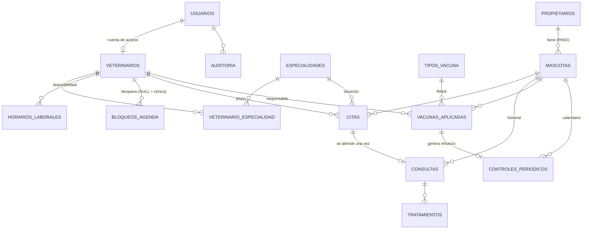

# Informe técnico — Examen práctico Full Stack

| | |
|---|---|
| **Universidad** | Universidad Católica de Cuenca — Facultad de Informática, Ciencias de la Computación e Innovación Tecnológica |
| **Carrera** | Sistemas Computacionales — Matriz Cuenca |
| **Asignatura** | Programación Web · Quinto ciclo · Paralelo 5A |
| **Docente** | Ing. Luis Fernando Pinos Castillo |
| **Estudiante** | Javier Alexander Carrera Rodríguez |
| **Caso asignado** | **Caso 06 — Citas y servicios veterinarios** |
| **Sistema** | VetCare |

---

## 1. Problemática y justificación

Las clínicas veterinarias pequeñas y medianas suelen gestionar citas en cuadernos u hojas de cálculo, lo
que provoca **citas superpuestas** para un mismo veterinario, turnos asignados en horarios en que el médico no
atiende, **historiales clínicos dispersos** y, sobre todo, **olvido de refuerzos de vacunas** y controles
periódicos, con riesgo para la salud de las mascotas (p. ej. la antirrábica obligatoria).

VetCare centraliza el proceso: registro de propietarios y mascotas, agenda con disponibilidad real de cada
veterinario, registro clínico (consultas, diagnósticos, tratamientos, vacunas) y un **calendario de vacunación
con alertas automáticas** que avisa al personal antes de que un control venza.

## 2. Objetivos

**Objetivo general.** Desarrollar una aplicación web Full Stack que gestione las citas y los servicios de una
clínica veterinaria, integrando una API REST segura, una base de datos relacional y una interfaz web, con
reglas de negocio, auditoría y funcionalidades innovadoras.

**Objetivos específicos.**
1. Diseñar un modelo relacional con integridad referencial para propietarios, mascotas, veterinarios, citas e historial clínico.
2. Implementar una API REST por capas con autenticación JWT, autorización por roles, validación de DTO y manejo uniforme de errores.
3. Aplicar al menos cinco reglas de negocio del caso, con transacciones y control de concurrencia.
4. Construir un Frontend Angular modular, responsivo y accesible, conectado realmente a la API.
5. Incorporar tres o más funcionalidades innovadoras: calendario con alertas, notificaciones automáticas, asignación inteligente de horarios y PDF con QR.
6. Verificar el sistema con pruebas automatizadas de escenarios correctos, erróneos, de seguridad y de concurrencia.

## 3. Justificación de las tecnologías

| Componente | Elección | Justificación |
|---|---|---|
| Backend | **Node.js + Express 5** | Ligero, asíncrono (ideal para E/S con BD), Express 5 captura errores de funciones `async` sin código extra. Mismo lenguaje que el Frontend. |
| Validación / DTO | **Zod** | Define el contrato de entrada de cada endpoint en un solo lugar, sanea los datos y genera mensajes por campo. |
| Base de datos | **MySQL 8 (InnoDB)** | Relacional, con transacciones ACID, bloqueos de fila (`FOR UPDATE`), `CHECK`, índices únicos y triggers: todo necesario para las reglas del caso. |
| Seguridad | **JWT + bcrypt + Helmet + rate limit** | Sesiones sin estado, contraseñas con hash, cabeceras seguras y protección de fuerza bruta en el login. |
| Frontend | **Angular 22** | Framework completo: rutas con lazy loading y guards, formularios reactivos, interceptores HTTP, signals para estado reactivo, TypeScript estricto. |
| Documentación | **OpenAPI 3 + Swagger UI** | Documentación navegable y ejecutable en `/api/docs`. |
| Innovación | **PDFKit, qrcode, node-cron** | Generación de PDF/QR en el servidor y tareas programadas sin servicios externos. |
| Pruebas | **node:test + supertest** | Pruebas de integración contra la API real y la BD, sin dependencias pesadas. |
| Despliegue | Docker (MySQL), Render/Railway (API), Vercel/Netlify (Angular) | Frontend, Backend y BD desplegables de forma independiente. |

## 4. Arquitectura de la solución

```
┌──────────────────────┐   HTTPS / JSON + JWT   ┌──────────────────────────────────────────────┐   SQL    ┌──────────────┐
│  Frontend Angular    │ ─────────────────────▶ │  API REST (Express)                          │ ───────▶ │  MySQL 8     │
│  features/ (vistas)  │                        │  routes → middlewares (auth, roles, DTO)     │          │  InnoDB      │
│  core/services (HTTP)│ ◀───────────────────── │  → controller → service (reglas, transacc.)  │ ◀─────── │  triggers    │
│  guards/interceptors │   { data, meta } |     │  → repository (SQL parametrizado)            │          │  índices     │
└──────────────────────┘   { error }            │  jobs/ (cron de alertas) · docs/ (OpenAPI)   │          └──────────────┘
                                                └──────────────────────────────────────────────┘
```

**Backend (por módulo de dominio):** cada carpeta de `src/modules` contiene
`*.routes.js` (endpoints y permisos) → `*.controller.js` (HTTP) → `*.service.js` (reglas de negocio,
transacciones, auditoría) → `*.repository.js` (SQL) y `*.dto.js` (esquemas de entrada y mapeo de salida).
Ningún archivo concentra la lógica: la regla de disponibilidad, por ejemplo, vive en
`disponibilidad.service.js` y la reutilizan citas y sugerencias.

**Frontend:** `core/` (modelos por dominio, servicios HTTP por apartado, guards, interceptores),
`shared/` (componentes reutilizables: estados de carga/vacío/error, paginador, diálogo de confirmación,
avisos, errores de campo), `layout/` (estructura con menú por rol) y `features/` (un componente por
apartado, cada uno con su **plantilla HTML separada**).

**Respuestas uniformes:** éxito `{ data }` o `{ data, meta }` (listados paginados); error
`{ error: { codigo, mensaje, detalles } }` con códigos HTTP 400/401/403/404/409/422/500.

## 5. Modelo de datos



| Entidad | Descripción | Restricciones destacadas |
|---|---|---|
| `usuarios` | Cuentas y rol (ADMIN, RECEPCION, VETERINARIO) | email único, hash bcrypt |
| `propietarios` | Dueños de mascotas | cédula única (validada módulo 10) |
| `mascotas` | Pacientes; `codigo` UUID para el QR | FK `propietario_id` **NOT NULL** (RN02) |
| `especialidades` | Servicios y su duración estándar | nombre único, `CHECK` 10–240 min |
| `veterinarios` / `veterinario_especialidad` | Médicos y relación N:M con especialidades | cédula/email únicos |
| `horarios_laborales` | Bloques semanales de atención | `CHECK` día 1–7 e inicio < fin |
| `bloqueos_agenda` | Vacaciones, capacitaciones, feriados | `CHECK` inicio < fin |
| `citas` | Agenda: mascota + veterinario + especialidad | `version` para bloqueo optimista, índice (veterinario, inicio) |
| `consultas` / `tratamientos` | Historial clínico | `cita_id` único, triggers que impiden DELETE (RN05) |
| `tipos_vacuna` / `vacunas_aplicadas` | Catálogo e historial de vacunación | fecha, tipo y responsable NOT NULL (RN04); único (mascota, tipo, fecha) |
| `controles_periodicos` | Refuerzos, desparasitaciones y controles | índice (fecha, estado) para alertas |
| `notificaciones` | Alertas generadas automáticamente | único (tipo, referencia) → idempotencia |
| `auditoria` | Bitácora inmutable | triggers impiden UPDATE/DELETE |

## 6. Endpoints principales (prefijo `/api`)

| Recurso | Endpoints | Roles |
|---|---|---|
| Autenticación | `POST /auth/login`, `GET /auth/perfil`, `POST /auth/logout`, `PUT /auth/password` | público / todos |
| Usuarios | `GET/POST /usuarios`, `GET/PUT/DELETE /usuarios/:id` | ADMIN |
| Propietarios | `GET/POST /propietarios`, `GET/PUT/DELETE /propietarios/:id`, `PATCH /:id/reactivar` | lectura todos · escritura ADMIN/RECEPCION · baja ADMIN |
| Mascotas | `GET/POST /mascotas`, `GET/PUT/DELETE /mascotas/:id`, `GET /:id/historial`, `GET /:id/historial/pdf` | según operación |
| Especialidades | `GET/POST /especialidades`, `PUT/DELETE /especialidades/:id` | escritura ADMIN |
| Veterinarios | `GET/POST /veterinarios`, `GET/PUT/DELETE /veterinarios/:id`, `PUT /:id/horarios` | escritura ADMIN |
| Bloqueos | `GET/POST /bloqueos`, `DELETE /bloqueos/:id` | escritura ADMIN |
| Citas | `GET/POST /citas`, `GET/PUT /citas/:id`, `PATCH /:id/cancelar`, `PATCH /:id/no-asistio`, `GET /citas/disponibilidad`, `GET /citas/sugerencias` | creación ADMIN/RECEPCION; el VETERINARIO solo ve su agenda |
| Consultas | `GET/POST /consultas`, `GET /consultas/:id`, `DELETE` → 422 RN05 | registro ADMIN/VETERINARIO |
| Vacunas | `GET/POST /vacunas`, `DELETE` → 422 RN05, `GET/POST/PUT /tipos-vacuna` | aplicación ADMIN/VETERINARIO |
| Controles y calendario | `GET/POST /controles`, `PATCH /:id/realizado|cancelar|reprogramar`, `GET /calendario`, `GET /calendario/alertas` | todos |
| Notificaciones | `GET /notificaciones`, `GET /resumen`, `PATCH /:id/leida`, `PATCH /leer-todas`, `POST /generar` | todos · generar ADMIN |
| Reportes | `GET /reportes/indicadores`, `GET /reportes/citas?formato=csv` | indicadores todos · reporte ADMIN |
| Auditoría | `GET /auditoria` | ADMIN |
| Público | `GET /publico/carnet/:codigo`, `GET /salud` | sin sesión |

Todos los listados admiten **búsqueda (`q`), filtros combinados, ordenamiento (`orden`, `direccion`) y
paginación real (`pagina`, `tamano`)** en el servidor. La documentación completa está en Swagger (`/api/docs`).

## 7. Reglas de negocio

| Código | Regla | Implementación | Respuesta |
|---|---|---|---|
| **RN01** | Un veterinario no puede tener citas superpuestas | Se busca cualquier cita activa con `inicio < fin_nueva AND fin > inicio_nueva` dentro de una transacción que bloquea la fila del veterinario | 409 `RN01_CITA_SUPERPUESTA` |
| **RN02** | La mascota debe estar asociada a un propietario registrado | Validación en servicio + FK `NOT NULL` | 422 `RN02_PROPIETARIO_INEXISTENTE` / `_INACTIVO` |
| **RN03** | No permitir citas en horarios no laborables o bloqueados | La franja debe caber en un bloque de `horarios_laborales` y no cruzarse con `bloqueos_agenda` (del veterinario o de toda la clínica) | 422 `RN03_FUERA_DE_HORARIO` / `RN03_HORARIO_BLOQUEADO` |
| **RN04** | Una vacuna aplicada registra fecha, tipo y responsable | DTO obligatorio, responsable = veterinario autenticado (o elegido por ADMIN), columnas NOT NULL, fecha no futura ni anterior al nacimiento | 400 / 422 `RN04_*` |
| **RN05** | El historial clínico no se elimina mediante una operación ordinaria | No existe DELETE efectivo; el endpoint responde 422; triggers `BEFORE DELETE` en `consultas`, `tratamientos` y `vacunas_aplicadas`; la mascota solo se desactiva | 422 `RN05_HISTORIAL_NO_ELIMINABLE` |
| RN06 | No se agendan citas en el pasado | `validarFranja` | 422 `CITA_EN_PASADO` |
| RN07 | Una mascota no puede tener dos citas simultáneas | `validarFranja` + bloqueo de la fila de la mascota | 409 `RN07_MASCOTA_OCUPADA` |
| RN08 | El veterinario debe atender la especialidad solicitada | Relación N:M veterinario–especialidad | 422 `RN08_ESPECIALIDAD_NO_OFRECIDA` |
| RN09 | La vacuna debe corresponder a la especie | `tipos_vacuna.especie` | 422 `RN09_ESPECIE_INCOMPATIBLE` |
| RN10 | No duplicar la misma vacuna el mismo día | Verificación + índice único | 409 `RN10_VACUNA_DUPLICADA` |
| RN11 | Una atención se factura una sola vez | Índice único (origen, referencia) + verificación con `FOR UPDATE` | 409 `FACTURA_DUPLICADA` |
| RN12 | Las facturas no se eliminan, solo se anulan con motivo (ADMIN) | Trigger `BEFORE DELETE` + endpoint de anulación | 422 / 403 |
| RN13 | Lote de vacuna automático y consecutivo (PRE-AA-NNNN) | Conteo por tipo y año con bloqueo del tipo de vacuna | — |
| RN14 | Peluquería: se completa sin consulta y no antes de su fecha | `completarServicio` | 422 `CITA_FUTURA` / `SERVICIO_CLINICO` |

### 7.1 Transacciones
`config/db.js → transaccion()` envuelve `BEGIN / COMMIT / ROLLBACK`. Se usa en:
* **Registrar consulta:** consulta + tratamientos + cita → ATENDIDA + peso de la mascota + próximo control + auditoría.
* **Aplicar vacuna:** vacuna + cierre de refuerzos pendientes + nuevo control en el calendario + auditoría.
* **Desactivar mascota:** cambio de estado + cancelación de citas futuras y controles + auditoría.
* **Veterinario:** datos + especialidades (N:M) + horarios.
* Toda operación de escritura registra la auditoría **dentro** de la misma transacción.

### 7.2 Concurrencia
**Riesgo:** dos recepcionistas reservan al mismo veterinario a la misma hora en el mismo instante; ambos
leen "libre" y se crean dos citas superpuestas.
**Estrategia:**
1. *Bloqueo pesimista:* dentro de la transacción se ejecuta `SELECT … FROM veterinarios WHERE id = ? FOR UPDATE`
   (y lo mismo para la mascota). La segunda petición espera, vuelve a validar y recibe **409 RN01**.
   Verificado por la prueba **D1** (dos `POST /citas` en paralelo → exactamente un 201 y un 409, una sola fila en BD).
2. *Bloqueo optimista:* `citas.version`; reprogramar o cancelar exige la versión leída
   (`UPDATE … WHERE id = ? AND version = ?`). Si otro usuario cambió la cita → **409 CONFLICTO_VERSION** (prueba D3).
3. *Índices únicos* como última barrera: `consultas.cita_id`, `vacunas_aplicadas(mascota,tipo,fecha)`, `notificaciones(tipo,referencia)`.

## 8. Seguridad
* Inicio y cierre de sesión con **JWT** (expiración configurable); contraseñas con **bcrypt**; política de contraseña robusta.
* **Tres perfiles**: ADMIN (administrador), RECEPCION y VETERINARIO (operativos). Permisos verificados en cada ruta del Backend (`autorizar(...)`) y **a nivel de datos** (el veterinario solo ve/atiende su agenda).
* Helmet, CORS con lista blanca, límite de intentos de login, límite de tamaño del cuerpo.
* SQL parametrizado y ordenamiento con lista blanca de columnas (sin inyección SQL).
* Errores sin stack traces ni SQL; mismo mensaje para correo inexistente o contraseña incorrecta.
* Credenciales solo en variables de entorno (`.env` en `.gitignore`; se publica `.env.example`).
* Endpoint público del carnet: datos mínimos (sin cédula, teléfono ni diagnósticos) y con límite de peticiones.

### Auditoría
Cada operación importante registra **usuario, fecha/hora, acción, entidad y registro afectado**, además de
detalle (antes/después) e IP: login (exitoso y fallido), logout, crear, actualizar, desactivar, cancelar,
atender, aplicar vacuna, exportar PDF, generar alertas. La tabla es de solo lectura (triggers).

## 9. Funcionalidades del Frontend

| Vista | Funciones |
|---|---|
| Login | Validación, mostrar/ocultar contraseña, aviso de sesión expirada, retorno a la ruta solicitada |
| Panel | 8 indicadores, alertas de vacunación, próximas citas, gráficos de citas por estado/especialidad/día, especies y productividad |
| Propietarios | Búsqueda con espera, filtros, orden por columna, paginación, alta/edición con validación de cédula, detalle con mascotas, desactivar/reactivar con confirmación |
| Mascotas | Filtros combinados, alta/edición con búsqueda de propietario (RN02), historial clínico con pestañas y **descarga de PDF con QR** |
| Veterinarios | Especialidades (N:M), cuenta de acceso, **editor de horario laboral** |
| Especialidades / Tipos de vacuna | CRUD en una vista con formulario lateral |
| Bloqueos | Alta de bloqueos y lista de citas en conflicto devuelta por la API |
| Citas | Filtros (estado, veterinario, especialidad, fechas, texto), atender, reprogramar, cancelar con motivo, inasistencia |
| Nueva cita | Espacios libres reales, **sugerencias inteligentes**, mensajes de reglas de negocio destacados |
| Consultas | Registro con signos vitales, diagnóstico, tratamientos dinámicos y próximo control; detalle de solo lectura |
| Vacunas | Lista filtrable; aplicación con tipos compatibles con la especie y próxima dosis calculada |
| Calendario | Vista mensual con semáforo, alertas, panel del día, marcar realizado, reprogramar, cancelar |
| Notificaciones | Bandeja con filtros, marcar leídas, ejecutar revisión (ADMIN); campana con contador en la barra |
| Reportes | Filtros avanzados, resúmenes, detalle, exportación CSV e impresión |
| Usuarios / Auditoría | Gestión de cuentas y roles; bitácora con filtros y detalle JSON |

**UX y accesibilidad:** pestaña de accesibilidad con forma de media luna en el borde derecho de todas
las pantallas: **modo nocturno** (🌙/☀️, Alt+N) y **zoom de la interfaz de 50 % a 150 %** (Ctrl+Alt+ / Ctrl+Alt−),
preferencias guardadas en el navegador; selector de mascotas/propietarios con **lista desplegable y búsqueda**;
página pública del QR adaptable a celular, tablet y computadora; estados de carga, vacío y error con reintento; avisos de éxito/advertencia/error;
confirmación antes de operaciones destructivas; diseño responsivo (menú desplegable en móvil); enlace
"saltar al contenido", foco visible, etiquetas asociadas, `aria-live`, roles ARIA en diálogos/pestañas,
respeto de `prefers-reduced-motion`; navegación sin recargar la página (SPA con lazy loading).

## 10. Pruebas

Ejecución: `cd backend && npm test` → **33 pruebas, 33 aprobadas** (además, colección Postman en `postman/`).

| # | Escenario | Tipo | Resultado esperado | Resultado |
|---|---|---|---|---|
| C1 | Inicio de sesión correcto | Correcto | 200 + token, sin hash | ✔ |
| C2 | Registrar propietario y mascota | Correcto | 201 y relación creada | ✔ |
| C3 | Agendar cita en espacio libre | Correcto | 201, fin = inicio + duración | ✔ |
| C4 | Aplicar vacuna y programar refuerzo | Correcto | 201 + control en calendario | ✔ |
| C5 | Búsqueda + filtros + orden + paginación | Correcto | página ordenada y filtrada | ✔ |
| C6 | PDF del historial e indicadores | Correcto | `application/pdf` y 200 | ✔ |
| E1 | Campos obligatorios vacíos | Error | 400 con detalle por campo | ✔ |
| E2 | Cédula inválida | Error | 400 | ✔ |
| E3 | Cédula duplicada | Duplicado | 409 `CEDULA_DUPLICADA` | ✔ |
| E4 | Registro inexistente | Error | 404 controlado | ✔ |
| E5 | JSON malformado / ruta inexistente | Error | 400 / 404 sin stack trace | ✔ |
| E6 | Credenciales incorrectas | Error | 401 con mensaje genérico | ✔ |
| E7 | Información inconsistente (cita de otra mascota) | Error | 422 y **sin datos parciales** | ✔ |
| S1 | Sin autenticación | Seguridad | 401 | ✔ |
| S2 | Token falsificado | Seguridad | 401 | ✔ |
| S3 | Recepción crea especialidad | Seguridad | 403 | ✔ |
| S4 | Recepción registra diagnóstico | Seguridad | 403 | ✔ |
| S5 | Veterinario accede a auditoría/usuarios | Seguridad | 403 | ✔ |
| S6 | Veterinario consulta cita ajena | Seguridad | 403 y lista filtrada | ✔ |
| S7 | Auditoría de operaciones | Seguridad | registro con usuario/fecha/acción/id | ✔ |
| RN01 | Cita permitida y cita superpuesta | Regla | 201 y luego 409 | ✔ |
| RN02 | Mascota sin propietario | Regla | 422 | ✔ |
| RN03 | Domingo, almuerzo y horario bloqueado | Regla | 422 | ✔ |
| RN04 | Vacuna sin tipo/fecha/responsable | Regla | 400 | ✔ |
| RN05 | Eliminar consulta (API y SQL directo) | Regla | 422 y trigger bloquea | ✔ |
| RN09 | Vacuna canina a un gato | Regla | 422 | ✔ |
| D1 | **Dos reservas simultáneas** | Concurrencia | un 201, un 409, una fila | ✔ |
| D2 | Vacuna repetida el mismo día | Duplicado | 409 | ✔ |
| D3 | Reprogramar con versión vieja | Concurrencia | 409 `CONFLICTO_VERSION` | ✔ |
| D4 | Cancelar dos veces | Duplicado | 422 | ✔ |
| D5 | Ejecutar dos veces el job de alertas | Idempotencia | 0 alertas nuevas | ✔ |
| C7 | Reporte incluye la vacuna aplicada hoy (y CSV de vacunas) | Correcto | aparece en la sección | ✔ |
| C8 | Recordatorio por correo sin configuración | Error | 422 controlado | ✔ |

> Agregue aquí las capturas de pantalla de la ejecución de `npm test`, Swagger y la interfaz.

## 11. Funcionalidades innovadoras

1. **Calendario de vacunación con alertas de próximos controles** (propuesta del caso).
   Cada vacuna con intervalo de refuerzo genera automáticamente un control en `controles_periodicos`.
   El calendario mensual muestra un semáforo (vencido, próximo ≤ 7 días, programado, realizado) junto
   con las citas; desde el panel del día se aplica la vacuna, se marca realizado o se reprograma.
2. **Notificaciones automáticas por correo.** `jobs/alertas.job.js` se ejecuta con `node-cron` (cada hora y al arrancar):
   detecta controles próximos/vencidos y citas del día siguiente, crea la alerta en el sistema (campana y
   bandeja de notificaciones) y **envía un correo HTML al propietario desde el correo del administrador**
   (Gmail SMTP en local o API de Brevo en la nube). Es idempotente gracias al índice único: ni las alertas
   ni los correos se duplican. El estado de cada envío (enviado, error, sin correo) queda registrado y
   también se puede enviar un recordatorio manual desde el calendario.
3. **Algoritmo de asignación de horarios.** `GET /citas/sugerencias` recorre los próximos 14 días, toma
   los veterinarios que ofrecen la especialidad, calcula los huecos libres (horario laboral – bloqueos –
   citas, en pasos de 15 min y con la duración de la especialidad) y ordena por cercanía y menor carga
   del día, marcando la opción recomendada.
4. **Historial clínico en PDF con código QR.** `GET /mascotas/:id/historial/pdf` genera el documento
   (vacunas, próximos controles, consultas y tratamientos). El QR apunta a `/verificar/<código>`, página
   pública que confirma la autenticidad del carnet y la vigencia de cada vacuna.
5. **Panel de indicadores y reportes con filtros avanzados** (asistencia, cobertura de vacunación,
   productividad por veterinario) con secciones de citas, vacunas aplicadas y consultas, cada una
   exportable a CSV para Excel.
6. **Facturación automática por correo.** Cada consulta, vacuna o servicio de peluquería genera, en la
   misma transacción, una factura con subtotal, IVA (configurable, 15 %) y total. Al confirmarse se envía
   el PDF adjunto al correo del propietario desde el correo del administrador. La pantalla de Facturación
   permite descargar, imprimir, reenviar y anular (sin eliminar) cada factura; el reporte de **Ingresos**
   muestra el dinero recibido, la cantidad de servicios, los servicios más vendidos y el detalle por factura.

## 12. Enlaces
* Repositorio: _(agregar URL de GitHub)_
* Frontend desplegado: _(agregar URL)_ · API desplegada: _(agregar URL)/api/docs_

## 13. Conclusiones y posibles mejoras

**Conclusiones.**
* Separar el Backend en módulos con capas (rutas, controlador, servicio, repositorio, DTO) permitió
  reutilizar la lógica de disponibilidad en la creación de citas, la reprogramación y el algoritmo de sugerencias.
* Las reglas críticas se protegen en varias capas: Frontend (experiencia), servicio (regla), base de datos
  (restricciones, índices únicos y triggers), por lo que no dependen de la interfaz.
* La combinación de transacciones con `SELECT … FOR UPDATE` y bloqueo optimista eliminó las reservas
  duplicadas, comprobado con una prueba de peticiones simultáneas.
* El calendario con alertas automáticas convierte el historial de vacunación en una herramienta preventiva.

**Mejoras futuras.** Envío de recordatorios por correo/WhatsApp al propietario; portal del propietario;
adjuntar exámenes de laboratorio e imágenes; refresh tokens; despliegue con CI/CD y pruebas end-to-end del Frontend.
